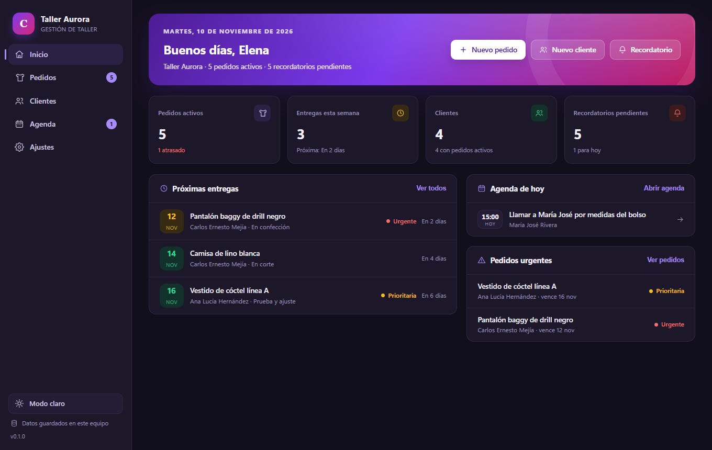
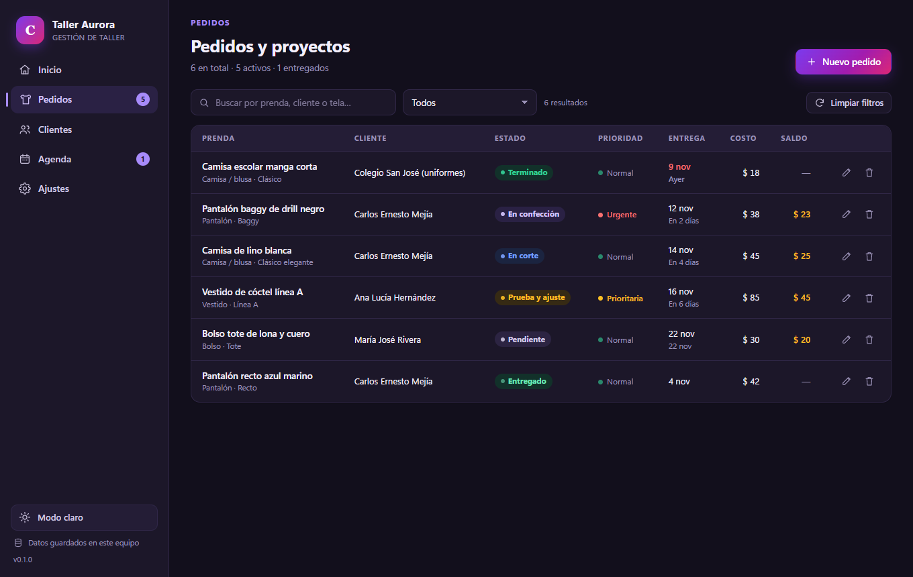
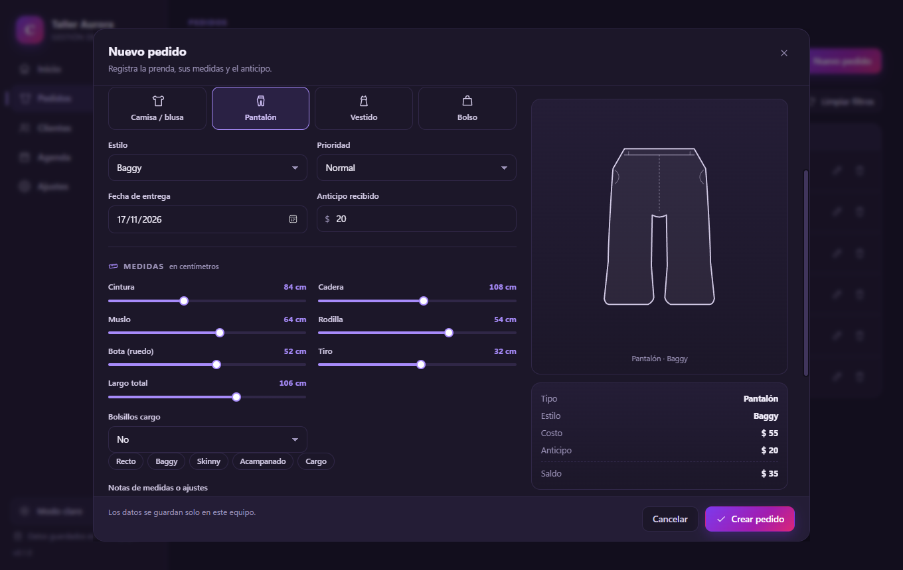
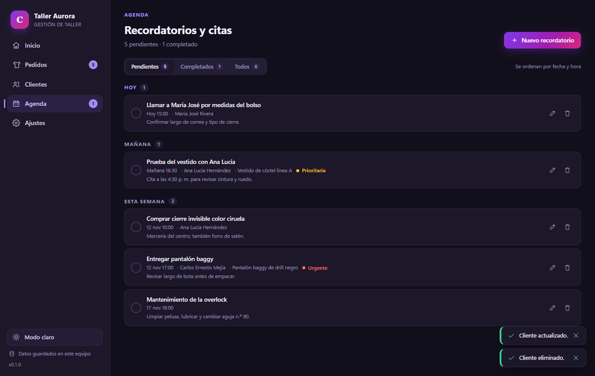

# Costura — gestor local de taller

Aplicación de escritorio para Windows donde una persona lleva su taller de costura:
clientes, pedidos con medidas, agenda de recordatorios y bitácora de cada prenda.
Todo se guarda **en el propio equipo**. No hay cuentas, ni nube, ni panel de
administrador, ni pasarela de pagos.

Hecha en **Rust** con **Tauri 2**; la interfaz (HTML/CSS/JS) se ejecuta dentro de
la app con WebView2, sin servidor ni navegador externo.






## Qué puedes hacer

- **Inicio**: resumen del taller, entregas próximas, agenda del día y pedidos urgentes.
- **Clientes**: alta, edición y borrado; teléfono, correo, dirección y notas; historial
  de pedidos y saldo por cobrar.
- **Pedidos**: prenda, tipo (camisa, pantalón, vestido, bolso u **otro proyecto personalizado**), estilo, prioridad, fecha de entrega, tela, costo, anticipo, **consumo de insumos con cálculo de costo** y **fotos del resultado final**.
- **Insumos**: control completo de inventario (tela, hilo, botones, cierres, elástico, entretela y otros), existencias, alertas de stock bajo o agotado, entradas de mercancía y descuento automático según el consumo en cada pedido.
- **Medidas e imágenes**: formulario adaptable según el tipo de prenda, con medidas en centímetros, dibujo de patrón en SVG y **galería de imágenes de referencia del resultado final**.
- **Vista previa**: dibujo del patrón en SVG que cambia con las medidas y el estilo.
- **Bitácora**: etapas del pedido (pendiente, corte, confección, prueba, terminado,
  entregado) y notas fechadas.
- **Agenda**: recordatorios con fecha y hora, prioridad y vínculo a cliente o pedido;
  se agrupan en atrasados, hoy, mañana, esta semana y más adelante.
- **Ficha imprimible** de cada pedido (medidas, costos, tela y bitácora).
- **Modo claro y oscuro**.
- **Respaldos locales**: copia manual, copia automática diaria, restauración y
  carpeta de respaldos a la vista.

## Cómo abrirla

1. Entra a la carpeta `Costuraprogram`.
2. Haz doble clic en **`Costura.exe`**.

Requisitos: Windows 10 u 11 con el runtime **WebView2** (viene instalado en Windows 11
y en Windows 10 actualizado; si falta, Windows lo ofrece al abrir la app).

La primera vez la aplicación abre vacía, con dos atajos: crear el primer cliente o
cargar un taller de ejemplo desde **Ajustes → Cargar datos de ejemplo**.

## Dónde quedan tus datos

- Archivo principal: `%APPDATA%\CosturaTaller\costura.json`
- Copia de la versión anterior: `costura.json.bak`
- Respaldos: `%APPDATA%\CosturaTaller\backups\` (se conservan los últimos 40)
- Caché de la interfaz: `%APPDATA%\CosturaTaller\webview\`

Si esa carpeta no se puede escribir (equipos con políticas restrictivas), la aplicación
usa una carpeta **`datos`** junto al ejecutable y lo avisa al iniciar. La ruta exacta
siempre se muestra en **Ajustes → Dónde se guardan tus datos**, con botones para abrirla.

Cada usuario de Windows tiene su propia carpeta: si dos personas comparten el mismo
usuario del equipo, comparten también los datos. Puedes forzar otra ubicación con la
variable de entorno `COSTURA_DATA_DIR` (por ejemplo, una carpeta en un USB).

Cada cambio se escribe de forma atómica (archivo temporal + reemplazo) y antes de
reemplazar se guarda una copia `.bak`. Si el archivo principal se corrompe, la app
intenta recuperar el `.bak` y avisa.

Para llevar tus datos a otro equipo: copia `costura.json` (o un respaldo) a la misma
ruta en el otro equipo. También puedes usar un USB y la opción de restaurar.

> La aplicación no se conecta a internet. No hay envío de datos, telemetría ni cuentas.

## Cómo compilar

Requisitos: Rust estable (probado con 1.97), Visual Studio Build Tools (C++) y las
crates en caché (el proyecto compila sin red).

```powershell
cd Costuraprogram\src-tauri
cargo build --release --offline
```

El ejecutable queda en `src-tauri\target\release\costura.exe`. El archivo
`Costura.exe` de la raíz es una copia de ese ejecutable, lista para usar (la carpeta
`target` no se distribuye porque pesa varios GB).

Para desarrollo con recarga de la interfaz:

```powershell
cd Costuraprogram\src-tauri
cargo run
```

## Estructura

```
Costuraprogram/
├─ Costura.exe              ← aplicación lista para ejecutar
├─ src/                     ← interfaz (HTML, CSS y JS sin dependencias)
│  ├─ index.html
│  ├─ css/app.css
│  └─ js/ (app.js, garments.js)
├─ src-tauri/               ← backend en Rust
│  ├─ src/main.rs           ← arranque y estado compartido
│  ├─ src/model.rs          ← modelos, validaciones y pruebas
│  ├─ src/store.rs          ← archivo JSON, respaldos y recuperación
│  ├─ src/commands.rs       ← comandos que usa la interfaz
│  ├─ tauri.conf.json
│  └─ icons/
├─ tools/                   ← utilidades de desarrollo y control de calidad
├─ shots/                   ← capturas de las pruebas
└─ README.md
```

## Decisiones de diseño

- **Sin login ni administrador**: es un programa personal; quien abre la app en el
  equipo tiene acceso a todo. No hay roles ni cuentas que desactivar.
- **Sin pagos**: el costo y el anticipo son solo registro; no se cobra nada.
- **Todo local**: un archivo JSON legible, sin base de datos que instalar ni servicio
  que mantener. Para el volumen de un taller (miles de registros) es más que suficiente.
- **Validación en el backend**: nombres, fechas, montos y medidas se validan en Rust,
  no solo en la interfaz.
- **Respaldos redundantes**: `.bak` en cada guardado, copia automática diaria, copia
  manual y copia previa a operaciones destructivas.

## Pruebas realizadas

- `cargo test`: 9 pruebas de modelos y almacenamiento (validaciones, guardado,
  respaldos, recuperación desde `.bak`, nombres de respaldo peligrosos).
- Recorrido automático de la interfaz (CDP) sobre la app real:
  - crear pedido con medidas y preset, verlo en la tabla, abrir detalle;
  - cambiar etapa y agregar nota a la bitácora;
  - editar y eliminar pedido con confirmación;
  - crear, editar y eliminar cliente;
  - crear recordatorio, marcarlo completado y eliminarlo;
  - guardar ajustes, crear respaldo y restaurarlo;
  - cambiar de tema y comprobar que no hay errores de JavaScript.
- Primer uso: app vacía → crear cliente → continuar automáticamente al pedido.
- Persistencia: recargar la interfaz conserva los datos; reiniciar la app también.
- Generación de la ficha imprimible verificada (sin abrir el diálogo del sistema).

## Limitaciones conocidas

- Conviene usar una sola ventana a la vez; dos instancias escribiendo el mismo archivo
  pueden pisarse los cambios (el archivo siempre queda íntegro, pero gana la última).
- No hay sincronización entre equipos ni copia automática a la nube (a propósito).
- El instalador MSI/NSIS no está generado; se entrega el ejecutable. Se puede añadir
  con `tauri build` si hace falta.
